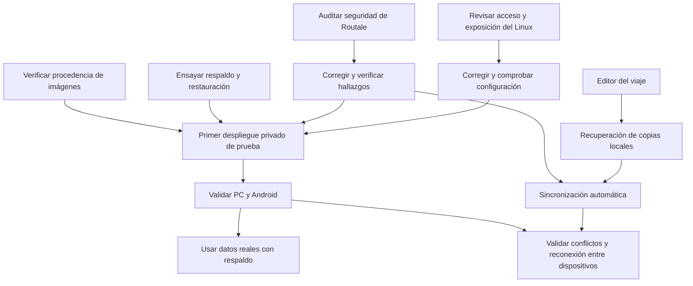

# Estado y siguientes entregas

Este documento resume el estado actual del código y las próximas entregas. Los
resultados de entregas antiguas permanecen en el historial de Git; no representan
la cantidad actual de pruebas ni el estado del servidor personal.

## Cómo avanzar y cerrar tareas

Organizar el trabajo por temática y entregar cambios pequeños, con una tarea
principal por PR. Este backlog es el registro de seguimiento; las guías enlazadas
conservan los detalles técnicos. No crear una segunda lista que pueda quedar desfasada.

- **Pendiente:** todavía no se ejecuta; puede tener preparación o evidencia antigua.
- **En curso:** se está trabajando y se registra qué falta.
- **Bloqueada:** indicar la dependencia o acceso que falta.
- **Completada:** enlazar PR/commit o evidencia de validación y sus límites.

Al cerrar una tarea, actualizar su estado, el criterio comprobado y la documentación
afectada en el mismo cambio. Una implementación probada en el entorno de desarrollo
no completa una comprobación del Linux ni del teléfono físico. No guardar direcciones,
credenciales, configuraciones privadas o respaldos personales como evidencia pública.

## Mapa de continuidad

**Revisión del Linux cerrada: SEG-01 y alcance IPv4 de SEG-02**, el
6 de noviembre de 2026. Se comprobaron listeners, Docker, permisos, Serve/Funnel,
SSH efectivo de la conexión y las ocho tablas filter/nat/mangle/raw de ambas
familias, sin truncar. La política restringida aprobada coincide con el filtro
recibido: PC administrativo al Linux TCP 22/443/9090, únicamente por IPv4.
Acceso permitido y recuperación LAN comprobados; Tailscale SSH deshabilitado.

El router conserva DMZ, mapeos y disparadores vacíos, y UPnP desactivado. Se
confirmó que la IPv4 pública probada desde el PC en la red móvil corresponde a
la WAN activa de Internet, configurada solo en IPv4; TCP 22/80/443/9090 agotaron
el tiempo desde esa conexión exterior. La gestión TR-069 usa otra WAN privada.
El Linux no tenía IPv6 pública ni ruta IPv6 predeterminada y no se amplió la
política para habilitar esa familia.

Users/Machines muestran una cuenta Owner, dos equipos propios, cero usuarios en
el filtro de invitados y ningún usuario externo con acceso a ambos equipos.
El cierre conserva límites explícitos: red interna del proveedor y firewall IPv6
global sin certificar, enlaces de invitación no utilizados no certificados y
prueba física de un tercer nodo afiliado sin permiso no realizada. El filtro
recibido y los tests de política aceptados respaldan la restricción de acceso.
No se exige registrar un equipo adicional solo para repetir esa comprobación.

La [evidencia de la revisión](despliegue-seguro.md#inventario-parcial-actualizado)
conserva detalle y límites; las salidas y direcciones permanecen privadas. La
[guía por etapas](inventario-linux.md) sirve para repetirla si cambian WAN,
publicaciones, reglas o dispositivos autorizados. Esto no certifica ausencia de
intrusiones ni habilita el despliegue. Dockge continúa detenido y Routale sigue
sin instalarse en el Linux. La preparación operativa sin Dockge se aplicó y validó en Linux en SEG-03. La revisión de dependencias de SEG-04 quedó registrada con sus avisos residuales; sigue OPS-01.
Los ensayos de respaldo pueden avanzar localmente.

## Seguridad y operación: preparar el primer despliegue

La columna Paso corresponde a los once puntos acordados en el chat. El paso 1
agrupa SEG-01 y SEG-02; los demás tienen una tarea principal. Esta tabla es la
única lista de seguimiento operativo. El orden indica la ruta prevista.
SEG-04, OPS-01 y OPS-02 pueden
desarrollarse sin esperar a que termine la revisión del host. El inventario
anterior no certifica el estado actual; los estados reflejan la evidencia disponible.

| Paso | ID | Estado | Tarea | Criterio para completarla |
| --- | --- | --- | --- | --- |
| 1 | SEG-01 | Completada: revisión del estado observado el 6 de noviembre de 2026 | Actualizar inventario del Linux | Captura completa del host, firewall IPv4/IPv6, SSH efectivo, Docker, permisos, Serve/Funnel, política y filtro de Tailscale; vistas de miembros y comparticiones, tablas del router y WAN de Internet IPv4. Dirección WAN confirmada contra la prueba móvil exterior de TCP 22/80/443/9090, todos sin conexión. Gestión TR-069 en otra WAN privada. [Evidencia, límites y condiciones de repetición](despliegue-seguro.md#inventario-parcial-actualizado); no se certifican la red interna del proveedor, el firewall IPv6 global ni pruebas físicas no realizadas. |
| 1 | SEG-02 | Completada: alcance IPv4 aprobado y comprobado | Restringir acceso y exposición | Grant amplio sustituido con aprobación por PC actual al Linux TCP 22/443/9090; regla SSH conservada, servidor Tailscale SSH deshabilitado. Política respaldada, tres tests aceptados, filtro recibido coincidente y acceso IPv4 permitido/recovery LAN comprobados. No concede IPv6 ni equipos nuevos. Prueba física de un nodo afiliado excluido no realizada; se conserva ese límite. La WAN pública coincide con la dirección probada desde la red móvil. No se cambiaron router, UFW ni sshd. |
| 2 | SEG-03 | Completada: preparación operativa aplicada y validada en Linux; Dockge contenido | Resolver la dependencia de Dockge | Configuración y guía instaladas por SSH en carpeta privada de usuario, permisos 700/600 y tres hashes coincidentes. Modelo validado con el Compose real del servidor; consultas de estado/registros ejecutadas correctamente sobre el proyecto bitacora. Sin .env activo, descarga de imágenes, contenedores nuevos, migraciones ni reinicios. Contenedores, tiempos/reinicios, volúmenes y redes existentes coinciden antes/después; Valheim intacto y Dockge detenido. La vulnerabilidad de Dockge no está corregida; reactivarlo requiere corrección verificable. Primer despliegue y reinicio real de Routale en OPS-03. Ver [operación](despliegue.md#operación-de-routale-por-composessh) y [contención](despliegue-seguro.md#dockge-requiere-una-corrección-upstream-verificable). |
| 3 | SEG-04 | Completada la revisión actual y las correcciones compatibles; residuales documentados | Auditar seguridad de Routale y revisar dependencias | Revisión estática anterior cerrada sin vulnerabilidades confirmadas en su alcance. En esta etapa se fija npm 11.21.2 en Docker/CI para corregir undici y brace-expansion; instalación limpia, 43 pruebas unitarias, tres del proxy, lint/tipos/build y Nginx pasan. Lockfile conservado. npm reporta diez moderados de desarrollo sin corrección compatible en los rangos de sus consumidores; NuGet no reporta paquetes vulnerables. Se conservan los avisos crudos musl/zlib de Scout y su evaluación por rama/componente con fuentes oficiales y binarios inspeccionados. La relectura completa del SDK no terminó y no se cuenta como validada; sus paquetes relevantes sí se comprobaron. [Evidencia y límites](#dependencias-y-pruebas-posteriores-al-scan). Publicación/procedencia y despliegue permanecen en OPS-02/03. |
| 4 | OPS-01 | En curso: transporte y recuperación de SQLite por SSH comprobados con datos ficticios | Respaldar y restaurar base y claves | Pasó el ensayo Linux → Windows con restic y la restauración por SSH a un directorio aislado en Linux. Coincidieron la base, el WAL y la clave ficticia. SQLite recuperó una fila del WAL y el corte de SSH no publicó un snapshot parcial. Pendientes el recorrido del ayudante con una imagen de Routale aprobada, la sesión y reanudación de la API, el destino y la contraseña definitivos, frecuencia, retención y la decisión sobre el cifrado del disco activo. Ver [procedimiento y límites](recuperacion.md#ensayo-y-operación-pendientes). |
| 5 | GIT-01 | Infraestructura integrada; rediseño en revisión | Preparar los cambios para Git | El [PR 6](https://github.com/Yianfri/routale/pull/6) integró operación y dependencias con checks aprobados. El rediseño se revisa en el [PR 7](https://github.com/Yianfri/routale/pull/7). La restauración del navegador queda para una entrega aparte. |
| 6 | OPS-02 | En curso: firma y verificador preparados | Verificar procedencia de web y API | El workflow prepara atestaciones y verifica el par por digest, nombre, repositorio, workflow, referencia y commit. Pruebas con un verificador simulado cubren referencias inválidas, fallo de la segunda imagen e intercambio de nombres. Quedan la publicación de prueba, verificación de atestaciones reales y repetición desde Linux. Ver [política de procedencia](despliegue.md#verificación-de-procedencia). |
| 7 | OPS-03 | Pendiente | Desplegar manualmente con datos ficticios | Tras SEG-02/03/04 y OPS-01/02, ejecutar migración separada y comprobar HTTPS, salud, sesión, guardado, reinicio y recuperación. Tener procedimiento de vuelta a imágenes, base y claves compatibles. No activar actualización automática. |
| 8 | VAL-01 | Pendiente | Validar PWA en PC y Android | Tras OPS-03, completar los recorridos físicos descritos abajo: instalación, cierre/reapertura, uso sin red y copias entre dispositivos, incluida caída y vuelta del servidor. |
| 9 | OPS-04 | Pendiente | Preparar operación con datos reales | Tras VAL-01, cerrar correcciones del ensayo, comprobar respaldos programados, acceso restringido y supervisión de disponibilidad/espacio sin registrar contenido personal. Conservar evidencia de restauración antes de importar datos reales. |
| 10 | OPS-06 | En curso: diseño local sin instalar | Alertar accesos y cambios administrativos por correo | Canal elegido por el propietario; preparación privada sin envío. Revisados servicios de registro y disponibilidad de lectura, sin exportar mensajes crudos. Preparar avisos de ingreso SSH, fallos repetidos agrupados y cambios administrativos acordados, con cobertura explícita para Cockpit/Dockge/Tailscale. Confirmar relay y destinatario, proteger secretos, limitar datos/volumen y probar cursor, rotación, caída del correo, recuperación y recepción real. No registrar comandos o diarios completos; un login no demuestra todas las acciones posteriores. Puede prepararse en paralelo a SEG-02; [alcance y límites](despliegue-seguro.md#alertas-de-acceso-y-cambios-administrativos). |
| 11 | OPS-05 | Pendiente | Automatizar el despliegue tras integrar a main | Objetivo solicitado: cambio aprobado integrado a main → CI aprobada → publicación de web/API → el Linux recoge y despliega la versión verificada, sin intervención manual habitual. Primero ensayar instalación y recuperación manuales. Completar el actualizador conjunto con procedencia, respaldo, migración y recuperación comprobados; probar fallos con datos ficticios. No ejecutar código de PR/forks en el Linux ni usar allí un runner de CI. La automatización sigue desactivada y update.sh todavía rechaza el stack con API. |

Consultar [despliegue](despliegue.md), [revisión operativa](despliegue-seguro.md)
y [migraciones](migraciones.md) al ejecutar estas tareas. Una recomendación de
seguridad no equivale a una vulnerabilidad demostrada.

## Implementado en la aplicación

- Angular/PWA responsive para escritorio, tablet y móvil, tema claro/oscuro,
  movimiento reducido, teclado y controles accesibles. [Dirección visual](direccion-visual.md).
- Bienvenida con paisaje y navegación unificada en Ruta, Diario y Mi copia.
  Ruta permite editar alojamiento, reserva, abastecimiento y plan B de una jornada
  existente, con guardado local y comprobación de revisión. El diario y la edición
  del plan usan panel lateral en escritorio y pantalla completa en móvil.
- Demo ficticia; importación y restauración de respaldos con validación y revisión.
- Itinerario por bloques de hasta siete jornadas, consulta de alojamiento y
  abastecimiento, navegación anterior/siguiente y selección de fecha.
- Diario por fecha real, creación/edición de notas y kilómetros sin duplicar la
  jornada. Borradores recuperables y guardado transaccional en IndexedDB.
- Exportación de un respaldo completo. Formato v1, identificadores históricos,
  extensiones, fuentes originales y hashes conservados.
- PWA con manifiesto, iconos y caché de aplicación. Preparación sin conexión y
  ayuda de instalación; los eventos de instalación se prueban de forma simulada.
- Angular conectado a ASP.NET Core .NET 10 y SQLite mediante Mi copia: sesión,
  vinculación explícita del perfil, listado, guardado y recuperación con revisión.
- Cuotas transaccionales, autorización por propietario, antiforgery y revisión
  condicional. Conflictos, edición entre pestañas y respuestas perdidas conservan
  los datos y evitan confirmar un guardado remoto inexistente.
- IndexedDB v2 con asociaciones por origen/cuenta, operaciones inciertas y archivo
  de copias reemplazadas. El archivo existe en almacenamiento; aún no tiene una
  pantalla para consultarlo y recuperar versiones locales anteriores.
- Estado de servidor no disponible, reconexión manual sin recargar y descarga de
  la copia local durante una caída. Volver a conectar no sube cambios automáticamente.

## Preparado para ejecutar y comprobar

- API por funciones y DTO separados, EF Core con LINQ, migraciones versionadas,
  adopción del esquema anterior y rechazo de esquemas incompatibles.
- Lanzador local y Compose de prueba: frontend, proxy, API y SQLite/claves
  persistentes, con cuentas aleatorias privadas para la instalación de prueba.
- Compose de producción con API sin puerto público y web en loopback por defecto.
  La receta requiere configurar HTTPS y migraciones antes de utilizarse en Linux.
- CI en ejecutores de GitHub: formato, lint, tipos, dominio/almacenamiento,
  migraciones .NET, HTTP/SQLite, navegador/PWA, integración real y Docker/Nginx.
- Publicación de imágenes web/API condicionada a `main` y
  `ENABLE_IMAGE_PUBLISH=true`. Publicar en GHCR no despliega la aplicación.
- La integración y su corrección de CI quedaron incorporadas mediante el
  [PR 4](https://github.com/Yianfri/routale/pull/4), con
  [comprobaciones aprobadas](https://github.com/Yianfri/routale/actions/runs/40127107559).

La mejora de disponibilidad tiene 41 pruebas frontend, 9 recorridos PWA y 7
recorridos de integración comprobados en Chromium del entorno de desarrollo.
La integración usa API y SQLite temporales e incluye caída, edición y exportación
sin conexión, reinicio y reconexión sin envío automático. Los resultados deben
quedar reflejados también en los checks de la PR. Esto no verifica el servidor
personal ni Android físico.

## Producto: código que puede avanzar sin el servidor personal

| ID | Estado | Entrega pendiente, en orden de prioridad | Criterio para completarla |
| --- | --- | --- | --- |
| PROD-01 | En curso | Completar la edición de logística de jornadas | Ya se editan alojamiento, reserva, abastecimiento y plan B con validación y control de concurrencia local. Faltan traslados y presupuesto. Conservar IDs, fuentes originales y extensiones. |
| PROD-02 | Pendiente | Editar estructura del viaje | Agregar, mover y reprogramar jornadas y etapas con vista previa del impacto. Conservar IDs, fuentes originales, extensiones, asociaciones remotas y el diario por fecha real. |
| PROD-03 | Pendiente | Consultar copias locales reemplazadas | Exponer el archivo de copias locales con vista previa y comprobación de ediciones concurrentes antes de restaurar. Incluye revisar y ofrecer la exportación del viaje destino. Completar antes de habilitar sincronización automática. |
| PROD-04 | Pendiente | Sincronización automática cuando sea posible | Con la app abierta, conexión y servidor disponible, enviar cambios pendientes y comprobar cambios remotos de la cuenta vinculada. Conservar trabajo offline, detectar conflictos y no reemplazar ediciones sin revisión. Validar sus cambios de seguridad y completar PROD-03 antes de activarla; comprobar también el recorrido físico entre dispositivos. |
| PROD-05 | Pendiente | Selector de viajes locales | La persistencia ya conserva varios viajes; falta elegir el activo y conservar su selección sin mezclar notas, borradores ni asociaciones remotas. |
| PROD-06 | Pendiente | Catálogo editable de lugares | Crear y editar lugares y sus vínculos con jornadas, sin inventar coordenadas ni perder datos desconocidos. |

El orden guía las próximas PR de producto; seguridad y operación tienen su propia
ruta en el mapa anterior. La edición local de logística es la primera parte del
editor. La sincronización automática sigue pendiente y
necesita activación explícita por perfil/cuenta, cambios pendientes durables,
precondiciones de revisión, recuperación de respuestas perdidas y reintentos acotados.
Volver a tener internet no demuestra que el servidor responda. Con la app cerrada,
una PWA no garantiza ejecutar tareas de sincronización en segundo plano.

Mapa integrado, proveedor y disponibilidad de cartografía sin red necesitan una
decisión explícita y otra entrega. Historial remoto de versiones, colaboración,
gestión pública de cuentas y empaquetado nativo se priorizarán según el uso real.

## Mantenibilidad del editor y las copias

La revisión de responsabilidades identifica estos cambios acotados para próximas
PR. Son pendientes de refactorización, no defectos de seguridad confirmados ni
motivo para reescribir toda la aplicación:

- Unificar los tipos de estado, resumen y vista previa de copias que hoy se
  declaran tanto en `RemoteCopiesService` como en `RemoteCopiesView`. Mantener
  contratos compartidos independientes de Angular y de la persistencia para que
  agregar estados no obligue a actualizar definiciones duplicadas.
- Separar progresivamente la comparación de contenido y reconciliación de envíos
  de la sesión y recuperación en `RemoteCopiesService`, conservando precondiciones,
  resultados inciertos y pruebas actuales. Extraer responsabilidades al implementar
  la sincronización; evitar capas o interfaces sin un consumidor real.
- Separar la actividad remota del bloqueo general en `App.remoteAction` antes de
  agregar trabajo en segundo plano. Un envío lento no debe impedir escribir y
  guardar una nota local; probar latencia, desconexión y edición durante el envío.
- Implementar las futuras ediciones del plan como la edición de logística, con
  operaciones de dominio y repositorio, transacción y comprobación de versión
  local. Los componentes editan formularios. Probar dos pestañas, datos inválidos
  y conservación de fuentes, extensiones y asociaciones remotas.

## Revisión de seguridad y comprobaciones pendientes

Se completó una revisión estática Standard del código público de la base auditada: 135 archivos
de texto, con auditor independiente, modelo de arquitectura, investigación de
frontend y validación de los controles en fuente. El informe, modelo y cobertura
quedaron en el registro local de Codex Security bajo el scan indicado en SEG-04;
no se copiaron rutas locales o datos del servidor a Git. No se confirmaron
vulnerabilidades reportables ni se hicieron correcciones de código por este scan.
Esto no certifica ausencia de fallas ni equivale a pruebas de ejecución.

Se revisaron en fuente:

- Sesiones, expiración/revocación, antiforgery y aislamiento por propietario; cambio
  de cuenta entre pestañas y origen/perfil de los datos locales.
- Importación, límites de cuerpo/complejidad, campos desconocidos, enlaces externos
  y renderizado de notas; archivos inválidos deben conservar el cuaderno existente.
- Revisión condicional, cuotas, concurrencia y respuestas perdidas. La futura
  sincronización no debe mezclar cuentas ni repetir escrituras sin comprobar estado.
- Cookies y proxies de confianza, HTTPS, exposición de puertos, cabeceras y caché
  de respuestas privadas en el stack integrado.
- Metadatos de lockfiles npm/NuGet, acciones y recetas de contenedores, permisos
  CI, exclusión de datos privados del build y referencias a secretos en fuente.
- Consumidores de volumen/claves, rutas de credenciales locales ficticias y
  límites del publicador/actualizador. La revisión de código y la del Linux son
  comprobaciones distintas.

Se excluyeron datos privados e inventarios reales ignorados, un archivo HTML
ajeno al producto, cinco payloads raster/ICO, dependencias instaladas y salidas
de build. No se ejecutaron la aplicación ni sus tests durante esta auditoría;
no se consultaron servicios, bases de avisos o registros de paquetes. Los locks
no demuestran que sus versiones estén libres de vulnerabilidades. Las consultas
y pruebas posteriores se registran a continuación; el informe cerrado conserva
su alcance original. Falta validar el despliegue real, HTTPS, permisos, procedencia
y restauración antes de usar datos reales.

Antes de cerrar el alcance completo de SEG-04, completar sus comprobaciones
restantes y revisar nuevos cambios de seguridad, incluida la futura sincronización.
No registrar recomendaciones como vulnerabilidades sin demostrar alcance e impacto.

### Dependencias y pruebas posteriores al scan

**Revisión actual del punto 3, 6 de noviembre de 2026.** Se fijó npm 11.21.2
en la etapa de compilación Docker, los tres jobs que preparan Node en CI y el
campo packageManager del frontend. Se conserva Node 24.22.1 y el lockfile sin
cambios adicionales. La [publicación oficial de npm](https://github.com/npm/cli/releases/tag/v11.21.2)
incluye undici 6.29.1; el paquete inspeccionado también incluye brace-expansion
5.0.12. La imagen realmente reconstruida ya no contiene las versiones anteriores
que originaban seis avisos altos de esas herramientas. Node y npm globales del
PC se conservaron; las pruebas usaron herramientas portables verificadas.

La auditoría actual de los manifiestos devuelve diez alertas moderadas, ninguna
alta o crítica. Todas las rutas afectadas del lockfile pertenecen a dependencias
de desarrollo del linter. El cambio respecto a las once anteriores también
refleja la actualización del rango del aviso; no se atribuye al cambio de npm.
El builder conserva avisos moderados de glob/minimatch incluidos en npm y lint.
Los consumidores publicados aún declaran rangos anteriores a las versiones
mayores corregidas. No se forzaron overrides ni los descensos propuestos por
audit fix --force. Revisar cuando los consumidores incorporen versiones
compatibles, o si esos componentes pasan a un camino de ejecución de producción.

Scout conserva resultados crudos altos/críticos que se contrastaron por paquete
y componente, sin ocultarlos ni cambiar el criterio del escáner:

- **musl, CVE-2026-107891:** las imágenes inspeccionadas incluyen Alpine 3.24 y
  musl 1.2.6-r3. El [rastreador oficial de Alpine](https://security.alpinelinux.org/vuln/CVE-2026-107891)
  marca r3 como corregido en 3.24, mientras r6 corresponde a edge. Se clasifica
  como corregido por el proveedor para ese paquete y rama concretos; no se
  mezclan repositorios ni se aplica una excepción general a otras versiones.
- **zlib, CVE-2026-4738:** Scout lo marca crítico por zlib 1.3.2-r1 y señala 1.4.
  Las [notas oficiales](https://github.com/madler/zlib/releases/tag/v1.4)
  sitúan ese defecto en contrib/infback9. La [receta Alpine inspeccionada](https://raw.githubusercontent.com/alpinelinux/aports/3.24-stable/main/zlib/APKBUILD)
  construye e instala la biblioteca normal mediante configure/make, y su
  [Makefile de origen](https://raw.githubusercontent.com/madler/zlib/v1.3.2/Makefile.in)
  no incluye ese módulo entre los objetos de libz. Los archivos instalados y
  las bibliotecas de compilación, web, API y SDK inspeccionadas no contienen
  infback9/GDAL ni el símbolo inflateBack9; sí contienen los símbolos habituales
  inflate/inflateBack. Se registra como no aplicable a ese componente concreto,
  con hashes y consultas privadas, sin afirmar que toda versión de zlib esté
  libre de otros problemas ni haber ejecutado una explotación.

Los informes actuales de web y API contienen esos dos avisos crudos; el builder
contiene cinco entradas SARIF para cuatro CVE distintos, incluidos los dos
moderados de herramientas. Las clasificaciones anteriores se mantienen separadas
del informe original. NuGet no reporta paquetes vulnerables en la consulta actual
de ambos proyectos. Se detuvo la relectura completa de Scout del SDK, que
continuaba indexando y no corresponde a una etapa modificada en este cambio. No
se cuenta como inventario completo actual; curl/libcurl, musl, los archivos
instalados y la biblioteca zlib del SDK sí se inspeccionaron directamente.

Pasaron instalación limpia con npm fijado, formato, lint, tipos, 43 pruebas
unitarias, build de producción y tres pruebas del proxy. Se construyeron la etapa
de compilación y la web final; nginx -t y las comprobaciones HTTP de HTML, PWA,
salud y cabeceras pasaron en un contenedor temporal solo en loopback, retirado al
terminar. El primer intento de Vitest falló por permisos del temporal del sandbox;
pasó al usar un temporal privado del proyecto. Las pruebas del proxy necesitaron
acceso a loopback fuera del sandbox. No se modificaron las pruebas para ocultar
esos fallos del entorno. YAML de CI validado en formato y tres pins comprobados;
no se afirma una ejecución de GitHub Actions. No se accedió al Linux ni se publicó
ninguna imagen.

**Antecedentes de las consultas y correcciones anteriores:**

- npm: la consulta inicial reportó 18 alertas (tres altas, ninguna crítica).
  Angular CLI/build pasan a 22.2.5, framework/compiler/service worker a 22.2.4
  y Vitest a 4.1.12. El lock resuelve Vite 8.3.5, Zod 4.6.6 y fast-uri 3.1.9;
  desaparece la copia vulnerable de Zod anidada en CLI. Son dependencias de
  desarrollo; el Zod usado por la aplicación ya estaba corregido. La consulta
  posterior reporta 11 alertas moderadas por minimatch 10.2.6 y sus consumidores
  de lint, sin altas ni críticas. La [corrección publicada de minimatch](https://github.com/advisories/GHSA-g3hv-75wg-m249)
  requiere otra versión mayor: no se forzó una sustitución ni los descensos
  incompatibles sugeridos por audit. Pendiente reevaluar una solución compatible.
- NuGet: `dotnet package list --no-restore --vulnerable --include-transitive`
  consultó nuget.org con configuración aislada para ambos proyectos net10.0;
  no reportó paquetes vulnerables. No equivale a auditar el runtime del contenedor.
- Imágenes: Docker Scout consultó las bases públicas para linux/amd64 sin
  ejecutar contenedores. Nginx 1.30.5-alpine reportó 59 entradas de avisos;
  1.30.6-alpine elimina las de Nginx pero conserva 37 de bibliotecas del sistema.
  Se eligió `nginx:1.30.6-alpine-slim`, que conserva el servidor estático/proxy
  requerido y excluye módulos adicionales no usados. Su inventario reportó
  solo musl, CVE-2026-107891, versión 1.2.6-r3 y corrección indicada 1.2.6-r6,
  severidad no especificada por Scout (puntuación 3.1). La base ASP.NET 10.0-alpine
  reportó ese mismo aviso. La [fuente oficial de la variante mínima](https://github.com/nginx/docker-nginx/blob/master/stable/alpine-slim/Dockerfile)
  y los [avisos Nginx](https://nginx.org/en/security_advisories.html) sustentan
  la selección. Son inventarios de etiquetas mutables, no prueba de explotación
  ni certificación de las imágenes finales. Las construcciones y pruebas finales
  posteriores se detallan abajo; siguen pendientes musl, avisos de compilación,
  publicación por digest/procedencia y comprobación del despliegue real.
- Verificación histórica en el checkout anterior, con cambios adicionales del navegador: instalación limpia con npm 10.9.3, formato, lint,
  tipos de pruebas, 43 pruebas unitarias, build de producción, 10 pruebas de
  navegador/PWA, siete de integración con API/SQLite y tres del proxy local pasan.
  Navegador: Edge local; no es prueba física de Android ni ejecución de CI.
  La primera suite de integración agotó su timeout en el ensayo de caída; ese caso
  y luego los siete casos completos pasaron al ejecutarlos aisladamente, sin
  aumentar el timeout. Las suites usan salidas separadas para no borrar trazas
  de otra ejecución. La creación del lock usó npm temporal por un error interno
  del gestor anterior; no se cambió el npm global y `npm ci` habitual quedó probado.

### Recuperación de Docker y validación de imágenes locales

Docker Desktop no podía retirar un socket de inferencia de una sesión anterior;
Windows devolvía que el sistema no tenía acceso al archivo. Con Docker cerrado se
conservó con otro nombre únicamente la carpeta temporal de sockets. Al iniciar,
Docker regeneró los sockets y el motor respondió correctamente. No se restableció
la configuración, no se borraron imágenes ni volúmenes y no se cambió el Linux
personal. Los contenedores existentes que se iniciaron por su política de reinicio
se mantuvieron separados de las pruebas.

Se construyeron imágenes locales con etiquetas exclusivas de revisión y contextos
públicos. La web mínima pasa `nginx -t` con las tres configuraciones del repositorio.
El stack integrado usa la receta de producción, puertos solo en loopback y un
volumen nuevo con cuentas y respaldo ficticios. Pasan salud, cabeceras en HTML/PWA,
SPA y errores, cookies Secure/HttpOnly, CSRF, rechazo anónimo, aislamiento de cuentas,
conservación de extensiones, conflicto entre escrituras, persistencia de SQLite y
claves al reiniciar, conservación de sesión y revocación al salir. La API corre como
usuario `app`; ambos servicios usan raíz de solo lectura y no-new-privileges, y la
API elimina todas las capacidades. Se comprobó el proxy que espera terminación TLS
externa; no se probó un certificado HTTPS real en el servidor.

La revisión de compilación detectó avisos adicionales fuera de las imágenes runtime:

- Node 24.19.0-alpine: 58 entradas de avisos en su inventario. Se actualizan Docker,
  los tres jobs de CI y la recomendación de desarrollo a Node 24.22.1, manteniendo
  la misma familia compatible. La [publicación oficial es una actualización de seguridad](https://nodejs.org/en/blog/release/v24.22.1).
  La base nueva reporta 20 entradas, sin críticas; la etapa realmente construida,
  con dependencias del proyecto, reporta 21 entradas SARIF, seis altas y ninguna
  crítica. Las altas restantes están en undici y brace-expansion incluidas en las
  herramientas de npm. No se trasladan al Nginx final ni se afirma que el entorno
  de compilación esté libre de vulnerabilidades. Pendiente una actualización
  compatible del gestor/herramientas que cierre esos avisos.
- SDK .NET: la base consultada reportó 25 entradas, incluidas las de curl antiguo.
  La receta actualiza explícitamente curl y libcurl a un mínimo de 8.23.0-r0 antes
  de restaurar; publish hereda ese control. La transacción APK actualizó solo esos
  dos paquetes, y restauración con lockfile y publicación Release pasan. Ver
  [avisos oficiales corregidos en curl 8.23.0](https://curl.se/mail/lib-2026-10/0004.html).
  La etapa SDK reconstruida reporta solo el aviso musl, sin entradas altas o
  críticas ni avisos de curl. El runtime permanece separado y no copia las
  bibliotecas del SDK.
- Las imágenes web/API finales construidas y analizadas reportan únicamente el
  aviso musl indicado arriba, sin entradas altas o críticas. El repositorio Alpine
  configurado ofrecía musl 1.2.6-r3 al consultar, aunque Scout indica corrección
  1.2.6-r6; no se mezclaron repositorios de otras ramas para forzarla. Ese aviso
  permanece abierto, sin inferir su explotabilidad en Routale.

Se verificó Node 24.22.1 portable con el SHA-256 oficial, sin cambiar la instalación
global del PC. En una copia temporal del checkout anterior pasan instalación limpia, formato,
lint, tipos, 43 pruebas unitarias, tres del proxy, 17 HTTP/SQLite, diez de navegador
y siete de integración. Ambas imágenes compilan y el stack reconstruido pasa los
recorridos anteriores. La evidencia usa datos ficticios y queda local; no se afirma
ejecución de GitHub Actions ni validación física de Android. Los contenedores de
revisión se detienen al terminar y sus volúmenes de prueba se conservan separados.

## Validación pendiente en dispositivos físicos

- Instalar la PWA en Windows y Android, cerrar/reabrir y probar consulta/escritura
  sin red después de preparar la aplicación.
- Recorrer PC → guardar copia → Android → revisar/recuperar con el mismo origen
  HTTPS. Verificar también qué sucede con el servidor apagado y al volver.
- Comprobar almacenamiento y exportación en esos navegadores. Una instalación
  PWA no impide que el usuario borre los datos ni sustituye un respaldo.

## Trabajo pendiente en Linux

Existe un inventario previo de solo lectura; Routale todavía no está desplegada.
La [guía de despliegue](despliegue.md) y la
[revisión operativa](despliegue-seguro.md) describen el trabajo restante:

El seguimiento se realiza en los once pasos de la tabla inicial: SEG-01 a SEG-04,
GIT-01, OPS-01 a OPS-06 y VAL-01. La procedencia de imágenes y la recuperación deben
estar comprobadas antes del primer despliegue; la automatización viene después
del ensayo manual y la validación física.

El navegador es la copia de trabajo y el servidor conserva la última copia enviada
explícitamente. Un servidor apagado no impide editar localmente, pero sí guardar o
recuperar copias remotas y cargar la aplicación por primera vez en otro dispositivo.
El servidor conserva una sola versión remota por viaje; incrementar su revisión no
crea historial. Las decisiones y los datos personales permanecen fuera de Git.
